# Video Channel Health Monitor

A Python tool built on the YouTube Data API v3. It checks the recent uploads of 10 Canadian channels and flags the ones far above or below the views that channel's uploads usually have at the same age.

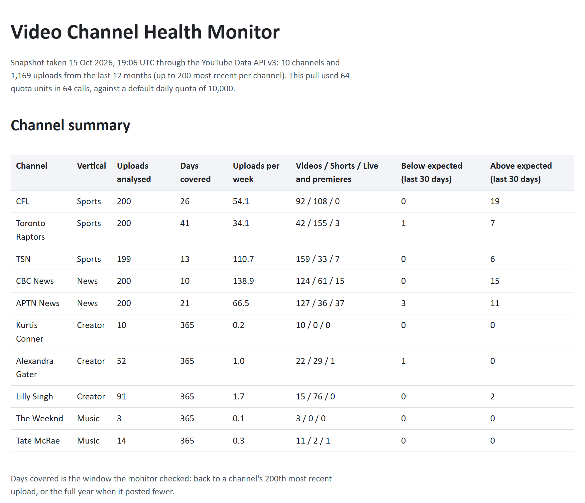

*The tool's report for snapshot 1, taken 15 Oct 2026, 19:06 UTC. Source: YouTube Data API v3. The flag columns are this project's own calculation.*

## At a glance

| Snapshot 1 | 15 Oct 2026, 19:06 UTC |
|---|---|
| Channels | 10 Canadian channels in sports, news, creators and music |
| Uploads analysed | 1,169 from the last 12 months |
| API use | 64 calls and 64 of the 10,000 daily quota units |
| Flags, last 30 days | 60 above expected, 5 below |
| Tests | 28 |

## Goal

Checking every channel's analytics by hand each morning takes too long for a team that looks after many channels. This tool runs that check for CFL, Toronto Raptors, TSN, CBC News, APTN News, Kurtis Conner, Alexandra Gater, Lilly Singh, The Weeknd and Tate McRae, using public data, and lists the recent uploads worth a closer look.

## Process flow

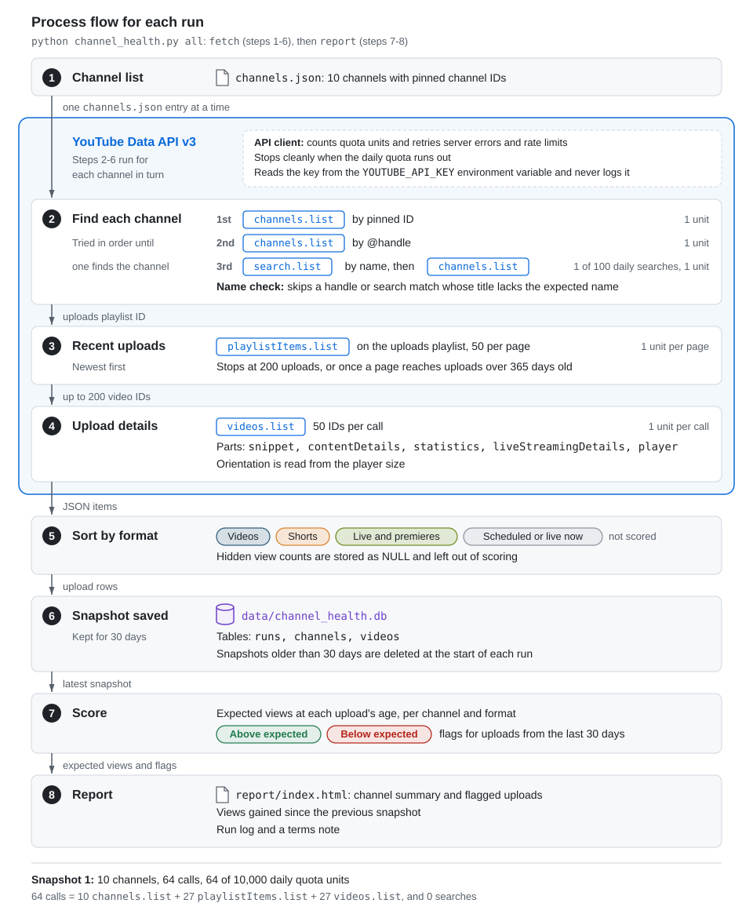

Each run reads the channel list, pulls recent uploads and their statistics from the API, and saves them as a snapshot in SQLite. It then scores every upload and writes the report. A full run for the 10 channels takes 64 API calls.

## Method

### Format of each upload

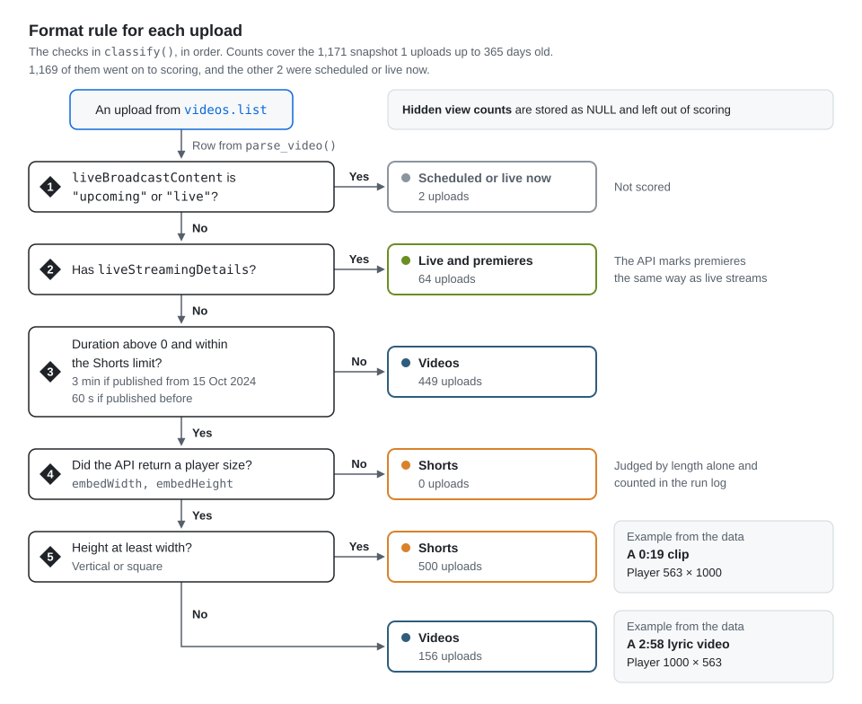

The Data API has no Shorts field, so the tool applies YouTube's own rule: a vertical or square upload up to 3 minutes long is a Short (60 seconds before 15 Oct 2024). Orientation comes from the player size the API returns. Premieres carry the same live-stream details as live streams, so the two share a group.

### Expected views at each age

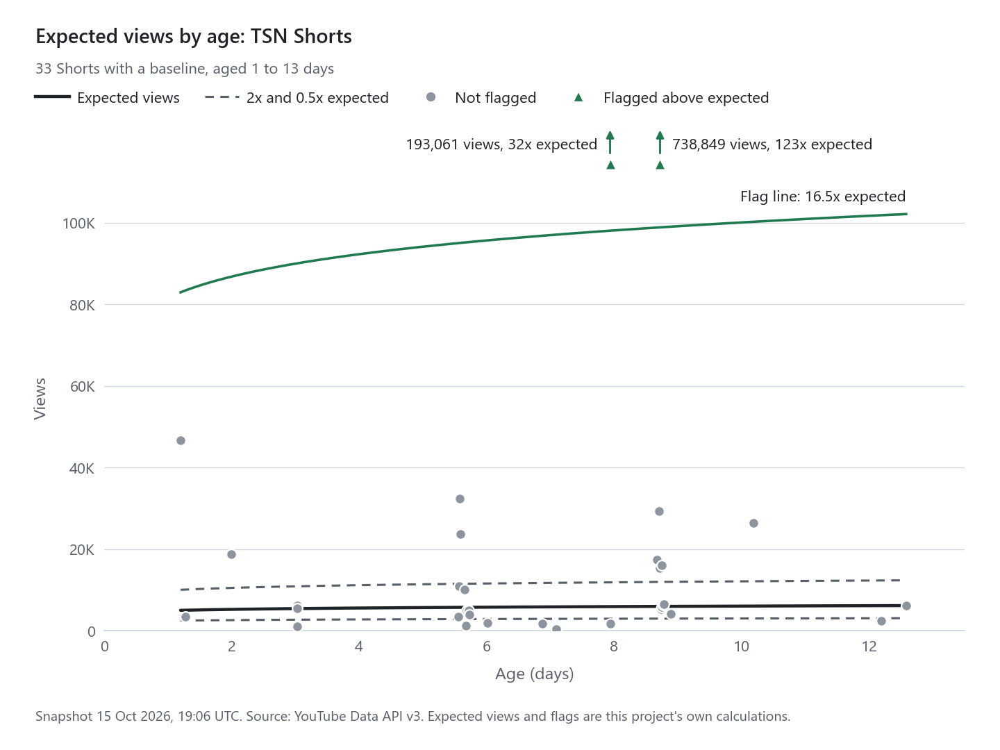

Views grow with age, so a 3-day-old upload is compared with what the same channel's uploads of the same format usually have at 3 days. For each channel and format with at least 8 uploads aged 1 to 365 days, the tool fits a line through log(views) against log(age) with the Theil-Sen method. It takes the median of all pairwise slopes, so a few breakout uploads have little effect on the line. Expected views is the line's value at an upload's age.

### Flags

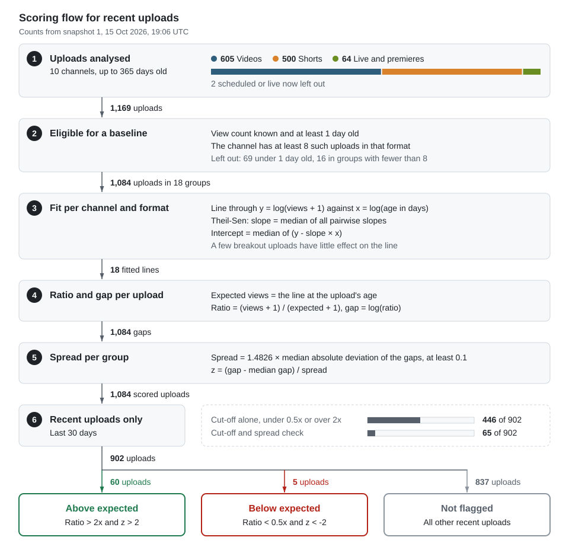

Views on busy sports and news channels often come in at a quarter or 4 times the expected figure. A plain cut-off at half or double would flag 446 of the 902 recent uploads, close to half of them.

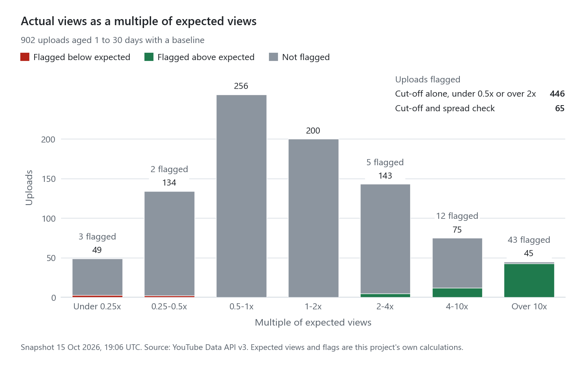

The tool also measures how unusual each gap is for that channel, using the median absolute deviation. An upload from the last 30 days is flagged when its views are under half or over double the expected figure and the gap is more than 2 robust standard deviations from the channel's usual spread. That leaves 65 flags: 60 above expected and 5 below.

### Channel lookup

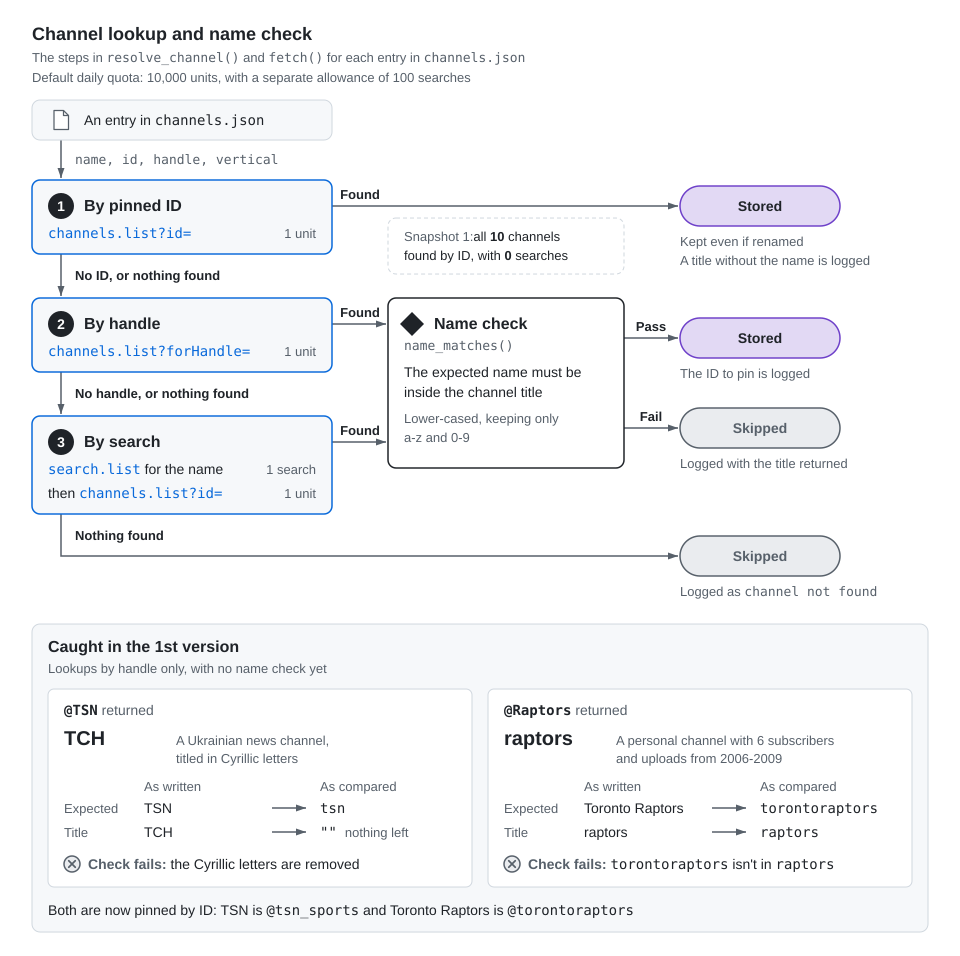

The 1st version looked channels up by @handle, and two lookups returned the wrong channel. @TSN returned ТСН, a Ukrainian news channel named in Cyrillic letters, and @Raptors returned a personal channel with 6 subscribers. Channels are now pinned by ID, and any lookup by handle or search is checked against the expected name before its data is stored.

### Snapshots

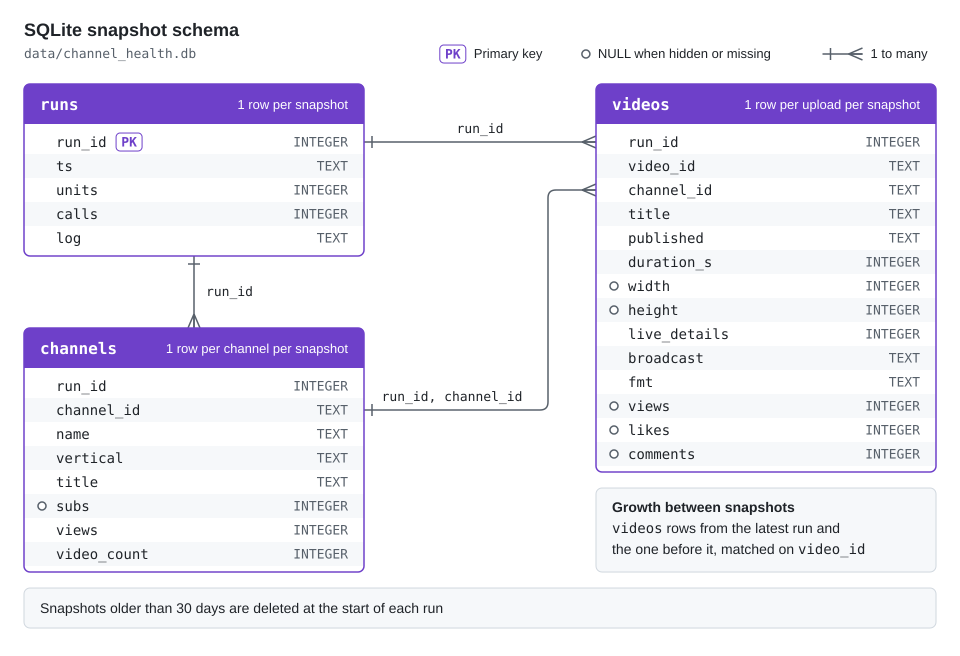

Each run is stored as a snapshot in 3 SQLite tables. The report compares the latest snapshot with the one before it to show views gained. Snapshots older than 30 days are deleted at the start of each run, in line with YouTube's rules on stored API data.

### Quota and errors

The client counts quota units for every call and counts searches separately, since `search.list` has its own allowance of 100 calls a day. It retries server errors and rate limits with backoff and stops cleanly if the daily quota runs out. Errors are logged without the request URL, which keeps the API key out of the log.

## Results

All figures below come from snapshot 1 (15 Oct 2026, 19:06 UTC) unless a chart says otherwise. Source: YouTube Data API v3.

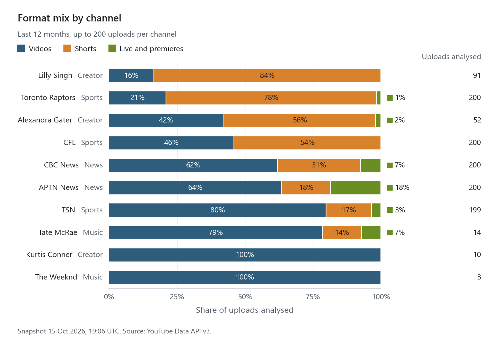

Shorts were 500 of the 1,169 uploads (43%). The mix ranged from 84% Shorts for Lilly Singh to none for Kurtis Conner.

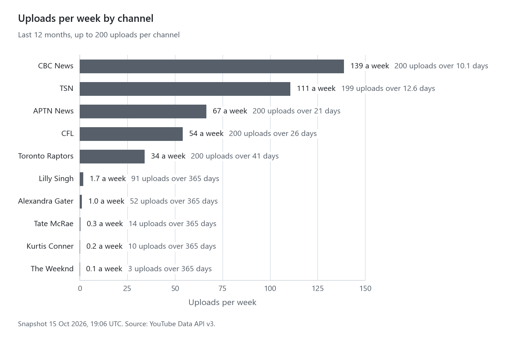

The busiest channels reached the 200-upload cap within days. CBC News's 200 most recent uploads covered 10 days, about 139 a week, so its baseline reflects those 10 days.

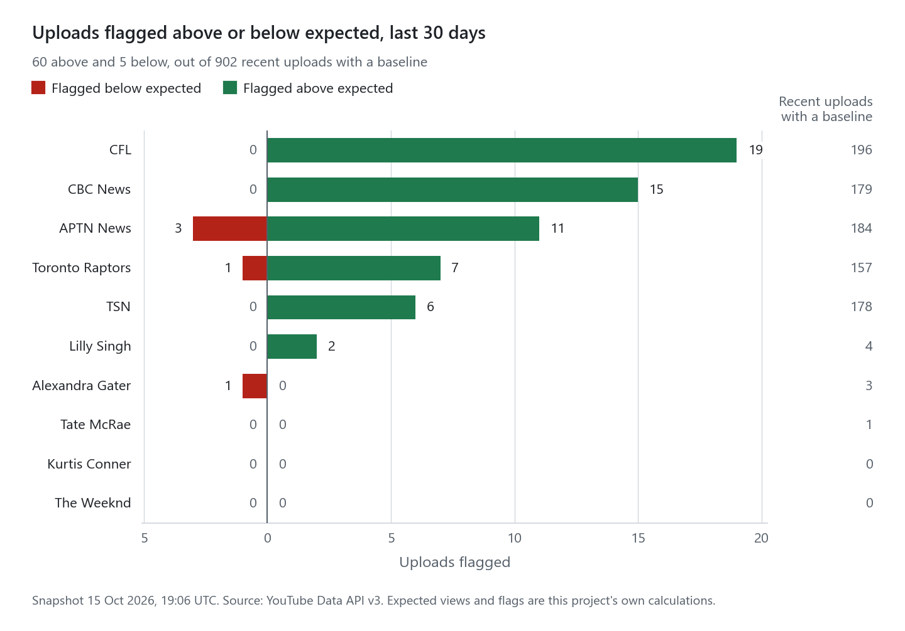

CFL had the most uploads above expected, with 19. The largest breakout was a TSN Short of Gavin McKenna with 738,849 views at 9 days old, about 123 times what TSN's Shorts usually have at that age. Two of the 5 uploads below expected were APTN News language versions of one program, in Plains Cree and Kanien'kéha.

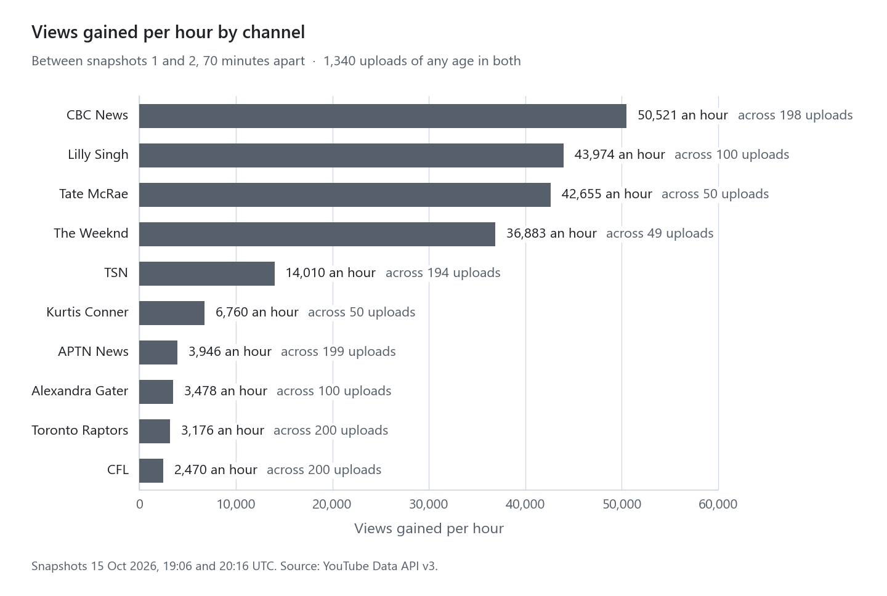

A 2nd snapshot 70 minutes later shows how fast each channel's uploads were gaining views. CBC News gained the most, 50,521 views an hour across 198 uploads. Tate McRae gained 42,655 an hour from 50 uploads.

## Setup

1. Install Python 3.11 or later, then run `pip install -r requirements.txt`.
2. In Google Cloud, enable the YouTube Data API v3 and create an API key restricted to that API.
3. Save the key as a user environment variable named `YOUTUBE_API_KEY`. On Windows, search the Start menu for "Edit environment variables for your account". The code reads the key from the environment and never writes it to the database, log or report.
4. Run `python channel_health.py all` to pull a snapshot and build `report/index.html`. Use `python channel_health.py report --run N` to rebuild the report for an earlier snapshot that's still stored.
5. Run `python make_figures.py --run N` to rebuild the charts in `docs/` from snapshot N, and `python -m pytest -q tests` for the 28 tests. The charts in this README come from snapshot 1.

## YouTube API policies

This tool uses YouTube API Services. By using it, you agree to be bound by the [YouTube Terms of Service](https://www.youtube.com/t/terms). See also the [Google Privacy Policy](https://www.google.com/policies/privacy).

The tool collects no personal data. Stored YouTube data stays on your machine in `data/` and `report/`, which `.gitignore` keeps out of the repo, and snapshots older than 30 days are deleted at the start of each run.

Expected views and flags are this project's own calculations. YouTube's Developer Policies allow derived metrics like these for API clients approved through the API Compliance Audit, under the Analytics & Reporting use case. This repo is a personal prototype, so a version for partners would go through that review first. The charts and figures here are dated examples from 15 Oct 2026.

Not affiliated with or endorsed by YouTube or Google.

## Limitations

- The tool sees public counts only, such as views and likes. Watch time, click-through rate, traffic sources and revenue need the channel owner's sign-in through the YouTube Analytics API.
- Expected views come from uploads of different ages in one snapshot, so a channel that is growing or shrinking quickly shifts its own baseline.
- Shorts are identified with YouTube's published length and orientation rule, since the API has no Shorts label. Official Artist Channels moved to the 3-minute limit later, on 8 Dec 2025, and the tool applies the 15 Oct 2024 date to every channel.
- Live streams and premieres are reported together, because the API marks them the same way.
- For channels that hit the 200-upload cap within days, the baseline reflects only those days.
- A flag marks an upload worth a look. Low views can also reflect a narrow audience, as with the language versions above.

## Files

- `channel_health.py`: API client, snapshot storage, scoring and report
- `make_figures.py`: builds the README charts from a stored snapshot
- `channels.json`: the 10 channels, pinned by ID
- `tests/test_channel_health.py`: 28 tests covering duration parsing, format rules, the trend fit, flagging, paging, quota handling, channel lookup and the 30-day clean-up
- `docs/`: the diagrams and charts in this README
- `report/`: the HTML report, written when you run the tool (not committed)
- `data/`: the SQLite snapshots (not committed)
